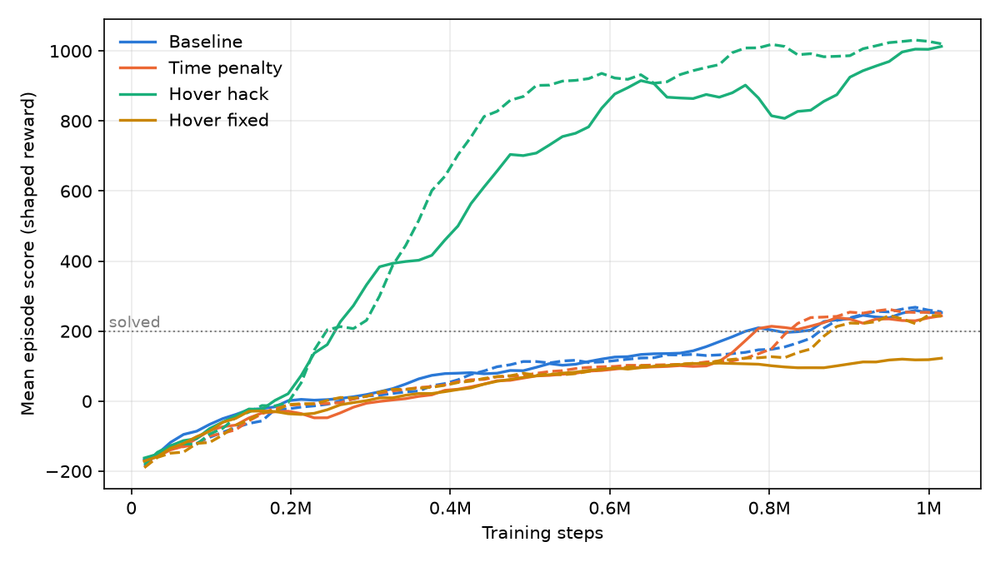
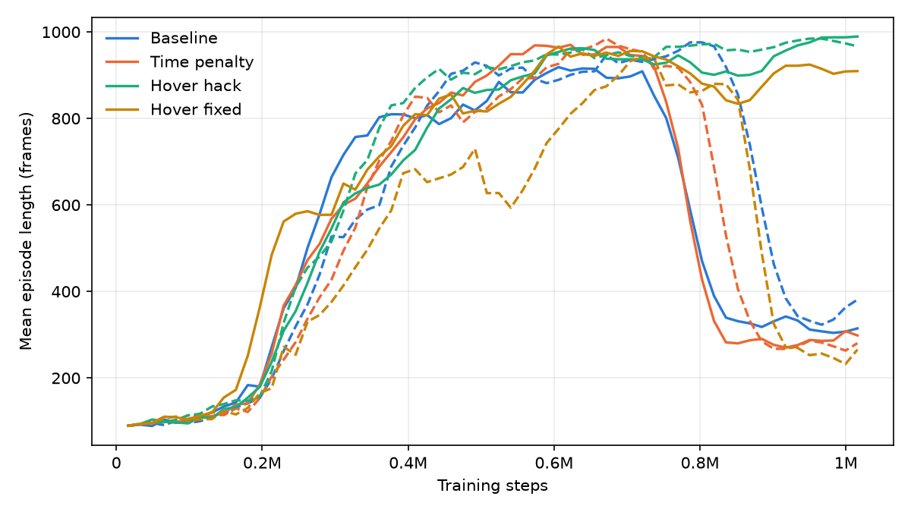

# Lunar Lander: Reward Hacking and Reward Shaping

A reinforcement learning agent learns to land a rocket in Gymnasium's **LunarLander-v3**. On purpose, I then gave it a reward that pays it for the wrong thing. It learned to **hover forever instead of landing**. Finally, I redesigned the reward so landing pays again.

- **Algorithm:** PPO (Proximal Policy Optimization) from Stable-Baselines3
- **Model:** a 9,797-parameter neural network (two 64-unit hidden layers)
- **Hardware:** CPU only, no GPU needed

## The experiment

Every frame, the agent sees 8 numbers: position, velocity, angle, angular velocity and whether each leg touches the ground. It picks one of 4 actions: do nothing, fire the left engine, fire the main engine or fire the right engine. It learns from the reward it gets.

I trained four versions of the reward, each on two random seeds:

| Variant | Reward |
|---|---|
| `baseline` | Gymnasium's built-in reward only |
| `time_penalty` | Built-in reward − 0.05 every frame |
| `hover_hack` | Built-in reward + 1 for every frame the rocket is upright and slow |
| `hover_fixed` | Built-in reward + the *change* in "upright and slow" since the last frame − 0.05 every frame |

### Why the hover hack breaks it

An episode ends after 1,000 frames. A rocket that hovers upright and slow can earn up to +1,000 from the bonus, and fuel costs it at most about 300. Landing ends the episode, and then the bonus stops. So, under that reward, hovering beats landing. The agent found this.

### How the fix works

The fixed reward pays for **progress, not position**. The agent gets +1 when it *becomes* upright and slow, and 0 for staying that way. Over a whole episode these bonuses add up to at most about 1, no matter how long it hovers. A 0.05 fee per frame makes waiting cost points.

## Results

Each trained agent was tested on 20 flights **with the custom reward turned off**, so a bonus cannot inflate its score. Lunar Lander counts an average of **200 or more** as solved.

| Reward | Seed | Score (mean ± std) | Landed | Crashed | Timed out | Train (min) |
|---|---|---|---|---|---|---|
| Baseline | 0 | 257.1 ± 21.5 | 20/20 | 0/20 | 0/20 | 2.9 |
| Baseline | 1 | 260.9 ± 20.3 | 20/20 | 0/20 | 0/20 | 2.9 |
| Time penalty | 0 | 265.5 ± 20.8 | 20/20 | 0/20 | 0/20 | 3.0 |
| Time penalty | 1 | 270.7 ± 19.5 | 20/20 | 0/20 | 0/20 | 3.0 |
| Hover hack | 0 | -94.0 ± 21.6 | 0/20 | 0/20 | 20/20 | 3.1 |
| Hover hack | 1 | -69.2 ± 28.2 | 0/20 | 0/20 | 20/20 | 3.1 |
| Hover fixed | 0 | 265.7 ± 19.8 | 20/20 | 0/20 | 0/20 | 2.9 |
| Hover fixed | 1 | 269.8 ± 22.3 | 20/20 | 0/20 | 0/20 | 3.0 |



The learning curves use the reward each agent was *trained* on. The hover hack's curve keeps climbing even though it never lands.



## Project structure

```
lunar-lander-reward-hacking/
├── lander/
│   ├── config.py        # environment ID, PPO settings, reward constants, paths
│   ├── rewards.py       # the reward wrappers and make_env()
│   ├── evaluation.py    # wrapper-off testing
│   └── results.py       # saving and loading results/*.json
├── random_agent.py      # fly with random actions
├── train.py             # train PPO on one reward variant
├── evaluate.py          # test a trained model with the wrapper off
├── record.py            # record a video of a trained model
├── summarize.py         # results table and plots
└── run_experiments.sh   # run everything
```

## What I learned

- An agent optimizes exactly what you reward, not what you meant. A reasonable-sounding bonus made the rocket stop landing completely.
- The training score can't be trusted on its own. The hover hack's training score went up while its real performance got worse. Watching the videos and testing with the bonus removed showed what was actually happening.
- Rewarding *change* instead of *state* closes this kind of loophole, because the bonus can't pile up over time.
- Training is random, so I ran every variant on more than one seed before drawing conclusions.

## Next steps

- Run more seeds to measure how consistent each reward is.
- Compare PPO with DQN on the same rewards.
- Try other shaping terms, such as fuel efficiency or landing closer to the center.

## Acknowledgments

- [Gymnasium](https://gymnasium.farama.org/) (Farama Foundation), the maintained successor to OpenAI Gym, for the LunarLander-v3 environment
- [Stable-Baselines3](https://stable-baselines3.readthedocs.io/) for the PPO implementation
